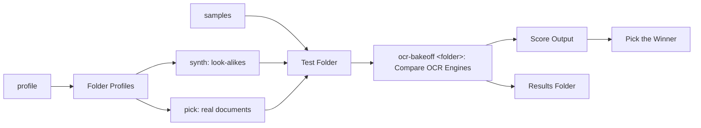

## Purpose

Which OCR engine reads *your* documents best? Point it at a folder, get a table.

```bash
uv run ocr-bakeoff ./testfiles
```

It runs up to eleven vision LLMs and five classic OCR engines over the same page images and
scores them on what actually breaks OCR in a document archive: **dropped headers and footers**
(letterheads, logos, register lines, footnotes — as text *or* as images), wrong or invented
numbers, lost umlauts, and degenerate output (loops, echoed prompts, truncation). Results come
per engine and per document kind.

Everything runs locally. Nothing leaves the machine unless you opt into the Google Drive
reference ([[Drive Reference]]). Results reproduce: the same documents give the same outputs and the same
scores on a rerun, and re-scoring cached outputs takes seconds.

## What it consists of

One note per command, per shared piece of scoring and per data file (decided 2026-10-26, owner: "split"; until then the README was the spec):

| Folder | Holds |
|---|---|
| `apps/mac` | [[Bakeoff Command]]: the commands, what a first run installs, the gate |
| `domain/features` | [[Compare OCR Engines]], [[Make Sample Folder]], [[Make Look-alikes]], [[Profile a Folder]], [[Pick Real Documents]], [[Show Lanes]] |
| `domain/functionality` | [[Score Output]], [[Pick the Winner]], [[Use the Text Layer]], [[Consensus Reference]], [[Drive Reference]] |
| `data` | [[Test Folder]], [[Results Folder]], [[Engine Lanes]], [[Folder Profiles]] |



## Rules

1. **Everything runs locally.** Nothing leaves the machine unless you opt into [[Drive Reference]].
2. **The terminal and `summary.md` carry aggregates only.** Document text goes to `<testdir>/.ocr-bakeoff/`, never to stdout; a Claude session running the tool sees stdout.
3. **Servers never download.** A model server gets local paths only; downloads happen after you saw the list and said yes (or passed `--yes`).
4. **Results reproduce:** the same documents give the same outputs and scores on a rerun, and re-scoring cached outputs takes seconds.
5. **Google Drive: trash, never delete.** Temporary Docs go to the Drive trash.
6. **Scoring parameters live in `config.py`** and follow [[Score Output]] and [[Pick the Winner]]; changing a threshold changes every past result, so the note records why.
7. **Published as `ocr-bakeoff`** (owner, 2026-10-26: "ocr-bakeoff as we share it publicly and its not a software where we can give it a greek name"). The public repository holds release commits only; the work happens in `ocr-bakeoff-private`.
8. **Weights are downloaded, never shipped** (2026-10-26, owner). Each model is fetched from its maker's or converter's Hugging Face page after you said yes, under that model's own licence, which [[Engine Lanes]] lists.

## Difference to today

- Rule 8: the licence list is in the notes and the README; the first-run list does not show a model's licence yet.
