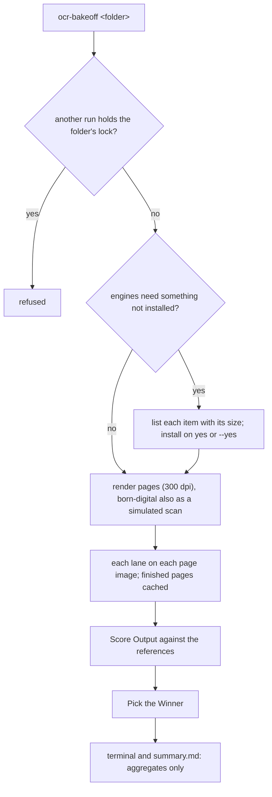

## Purpose

Runs the chosen engines over the same page images of a [[Test Folder]] and reports which reads it best, per engine and per document kind.

## Flow

## How it runs

`uv run ocr-bakeoff <folder> [--lanes ids|groups] [--skip ids] [--reference consensus|gdrive] [--baseline glm-custom] [--yes] [--force]`. A full run of every engine over a few dozen documents takes hours: `caffeinate -i uv run ocr-bakeoff ./testfiles`.

## Rules

1. **One run per folder:** a lock refuses a second one, and an interrupted run resumes where it stopped.
2. **Every model runs on its own `llama-server` with identical settings:** one slot, 16K context, temperature 0, 6144 image tokens. `--glm-url` reuses a GLM-OCR server you already run.
3. **Re-runs reuse everything already computed;** `--force` recomputes. If one engine's outputs come from different model files or versions, the table says so.
4. **The engines** are the [[Engine Lanes]]; `--lanes llm`, `classic`, `controls`, `pipelines`, `variants` or ids pick them.
5. **What it writes** is the [[Results Folder]].

## Difference to today

None.
